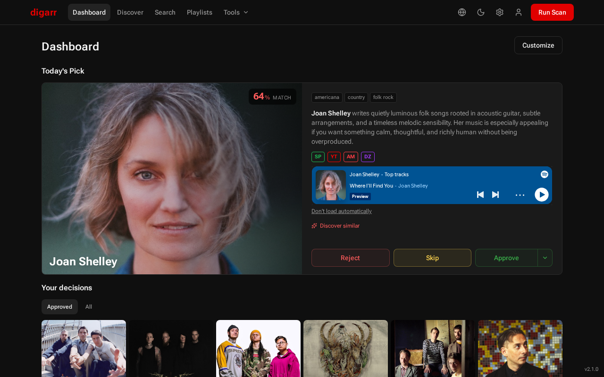

<p align="center">
  
</p>

<h1 align="center">Digarr</h1>

[](https://github.com/iuliandita/digarr/actions/workflows/ci.yml)
[](LICENSE)
[](https://bun.sh)
[](https://www.typescriptlang.org)
[](deploy/docker/)
[](https://github.com/iuliandita/digarr/actions/workflows/ci.yml)
[](https://github.com/iuliandita/digarr/releases)

**Self-hosted music discovery for your library.** Digarr finds artists and albums from your listening history or a mood. Review the suggestions, listen to previews, then send what you like to Lidarr, slskd, or a playlist. Bring your own AI provider or local model. Lidarr is optional.

> [!NOTE]
> **v2.0.1 is out.** This patch makes the automatic pre-migration backup work against the previous release's schema, so upgrading from v1.19.0 no longer needs `DIGARR_AUTO_BACKUP=false`. v2.0.0 changed discovery, album approval, saved playlist exports, and recovery, and binds SSO accounts to exact issuer/subject pairs. Existing installations must follow the [v2.0.x upgrade procedure](docs/OPERATIONS.md#upgrading-from-v1190-to-v200) before updating. See the [changelog](CHANGELOG.md) for release details.



This dashboard capture predates v1.19.0; see [current behavior and screenshots](docs/SCREENSHOTS.md).

[More screenshots](docs/SCREENSHOTS.md) | [Quick start](#quick-start) | [Configuration](#configuration) | [Documentation](#documentation)

## What you can do

- **Find artists and albums.** Connect a listening source, scan, and review scored suggestions. Release Radar finds new releases; Library Gap-Fill finds missing albums. Mood and artist searches work without a listening history.
- **Review before adding.** Preview, approve, reject, or permanently block suggestions. Individual and bulk album approval monitor and search only the recommended album in Lidarr. Automatic album approval also uses only the recommended release; its monitoring setting applies to artist recommendations.
- **Keep discovery running.** Schedule scans and subscriptions, or generate playlists from your connected libraries and catalog searches for Spotify and supported media servers. Saved playlists refresh their bound remote playlists; [explicit recovery](docs/OPERATIONS.md#playlists-and-notifications) handles uncertain creation and changed destinations. Audition playlists use pending artists without approving them. You can also export M3U/XSPF files. Media-server exports use music already in that server's library.
- **Share an instance.** Each user has their own queue, connections, and preferences; admins assign targets to each user. Local accounts and OIDC/SSO are supported, with 15 languages and light and dark themes.

Digarr calls your connected services. It doesn't include a downloader or a full music player.

AI suggestions and MusicBrainz matches can be wrong, so check the artist and release before approving. Playlist generation reports local results; it doesn't verify remote playback. Media-server exports require an exact artist/title match after case and whitespace normalization. Unmatched tracks are skipped, and omissions are reported in Job History. See [known limitations](docs/OPERATIONS.md#known-limitations).

### Connections at a glance

| Use | Services |
|-----|----------|
| Scan taste-profile sources | ListenBrainz, Last.fm, Spotify, Plex, Jellyfin, Emby, Subsonic, Discogs |
| [Deezer feeds](docs/AUTHENTICATION.md#deezer-app-setup) | Flow, favorites, followed artists, and playlists (own app required) |
| Library sync | Lidarr, Plex, Jellyfin, Emby, Subsonic |
| Approval and acquisition | Lidarr, slskd |
| Playlist export | Spotify, Navidrome, Jellyfin, Emby, Plex |
| Search | Spotify, Deezer, MusicBrainz; Bandcamp and TIDAL (both experimental) |
| AI recommendations | Anthropic, OpenAI, Gemini, Ollama, OpenAI-compatible endpoints |
| Notifications | Webhooks, ntfy, Telegram, Apprise |

A connection's capabilities differ by service. Release Radar requires ListenBrainz, Spotify, or Last.fm. Spotify Saved Albums and Followed Artists, Deezer Flow, and Subsonic Starred have focused discovery modes.

### Privacy and credentials

Your database runs on your server. Connected services still receive requests: hosted AI providers receive discovery prompts, metadata services receive lookups, and embedded previews contact their providers. A local AI model keeps AI requests local, but does not make all of Digarr offline.

Set and retain `DIGARR_ENCRYPTION_KEY` before saving service credentials. Without it, sensitive database fields are stored unencrypted. Back up the key separately from the database; losing it means re-entering encrypted credentials. Application exports preserve persistent state; a native consistent database backup is still required for exact schema rollback. Required automatic-backup failures stop migrations. See the [key rotation guide](docs/runbooks/encryption-key-rotation.md) before changing an existing key.

## Quick start

You need Docker and access to an AI provider or local model. Digarr includes an embedded PostgreSQL database (PGlite), so this runs as one container:

```sh
mkdir digarr && cd digarr &&
(set -C; umask 077 && key=$(openssl rand -hex 32) && printf 'DIGARR_ENCRYPTION_KEY=%s\n' "$key" > digarr.env) &&
docker run -d --name digarr --restart unless-stopped -p 127.0.0.1:3000:3000 \
  --env-file ./digarr.env \
  -e ALLOWED_ORIGIN=http://localhost:3000 \
  -e DIGARR_ALLOW_INSECURE_COOKIES=true \
  -v digarr-data:/app/data -v digarr-backups:/app/backups \
  docker.io/iuliandita/digarr:latest
```

This local-only HTTP example needs OpenSSL and saves the key in protected `digarr.env`. Retain that file for container recreation and recovery. The cookie override avoids browser-dependent Secure-cookie handling on localhost. For other devices, configure an [HTTPS public origin](docs/AUTHENTICATION.md#public-origin-and-reverse-proxies); deliberate HTTP exposes session cookies to interception.

Open `http://localhost:3000` and complete setup. Create the first account or sign in before the wizard. Passwords need 12 characters. The first account becomes admin; further local self-registration is closed by default. OIDC can still create accounts, so restrict access at your identity provider.

For unattended first boot, set both `DIGARR_INITIAL_USERNAME` and `DIGARR_INITIAL_PASSWORD` before starting. The configured admin must be created before HTTP opens; partial credentials or a password shorter than 12 characters stop startup. Leave both unset for manual registration. These settings never reset an existing account. Restrict access until you verify the intended admin. See [first-boot access](docs/AUTHENTICATION.md#users-and-targets).

Use `:latest` for the newest release, a minor tag like `:2.0` for patch updates, or a specific patch like `:2.0.1` to pin a release. Only the newest release receives security fixes. See [image channels](deploy/docker/README.md#image-channels).

For Compose, backend selection, and updates, follow the [Docker guide](deploy/docker/README.md). Keep one app instance per database, verify its backend at `/health`, and [back up before upgrading](deploy/docker/README.md#back-up-and-update).

## Your first recommendations

1. Sign in, then choose Lidarr, Emby, or discovery-only in the setup wizard and configure your AI provider, or skip it and rely on the listening sources you connect later. Requested settings, connections, and targets save together; a failed save leaves setup retryable.
2. Connect a listening source in Settings. Add library sources and targets when needed.
3. Run a scan from Dashboard or Discover.
4. Preview, approve, or reject suggestions. Adjust genre priorities in **Settings > Recommendations** if needed. Personal saves work for non-admins and global metadata controls are admin-only. Use Release Radar or Library Gap-Fill for albums. The net-new album toggle defaults to off and persists when saved.

CSV, M3U, and XSPF file imports and playlist imports process the listed artists into recommendations through separate subscription runs. Spotify's `Import Liked Songs` does the same for saved tracks. Imports do not become inputs to a normal scan. Spotify playlist imports honor the saved artist cap across pages; see [limits and playlist access](docs/API.md#subscriptions).

A scan can complete with a failed source. Admins can check Job History for partial results; other users can refresh Discover. Services without similar-artist lookup still contribute their supported listening and library data. See the [pipeline guide](docs/ARCHITECTURE.md#pipeline) for the details.

## Configuration

<a id="connecting-plex-listeners"></a><a id="importing-slskd-downloads-into-lidarr"></a><a id="data-hygiene"></a>
Use Customize on the Dashboard to show or hide any card, drag or use the keyboard to reorder cards, and choose small, medium, or large sizes. Layouts follow your account across devices. Empty cards hide by default; enable Show empty cards to keep them visible. Reset to default restores Today's Pick, Your decisions, Listening, Genres, and Subscriptions. Genres, Subscriptions, Discover's pending and decision views, and Settings > Connections have a Show on dashboard switch for their card.

Use Settings for connections, scoring, schedules, preferences, and language. For scripts, create a named, revocable credential in Settings > Account > API tokens with read, write, or admin scope and an optional expiry; [personal token setup](docs/AUTHENTICATION.md#personal-api-tokens) explains the one-time reveal and permissions. [Authentication](docs/AUTHENTICATION.md) covers origins, cookies, SSO, and proxies. [Operations](docs/OPERATIONS.md) covers Plex listeners, slskd imports, Data Hygiene, playlists, notifications, and local AI.

### Service apps

<a id="connecting-spotify"></a>**Spotify** needs your own OAuth app, a Premium app owner, and up to five allowlisted Development Mode users. Search needs a connected account. Local HTTP uses `127.0.0.1`, with the same `ALLOWED_ORIGIN` and browser address. Follow [Spotify setup](docs/AUTHENTICATION.md#spotify-app-setup) before changing the quick-start origin.

<a id="connecting-tidal"></a>**TIDAL is experimental:** authorization, refresh, and favorite-artist retrieval have not been tested with a live account. Catalog search needs admin-registered credentials; each user connects their own account for Favorite Artists. Follow [TIDAL setup](docs/AUTHENTICATION.md#tidal-app-setup). <a id="tidal-feedback"></a>The [feedback checklist](docs/AUTHENTICATION.md#tidal-feedback) explains what to report safely.

## Backup and restore

Application JSON exports preserve persistent application state and reject unsafe partial restores before writes. Required automatic-backup failures stop migrations. Retain the matching encryption key separately, and use a native consistent database backup for exact schema rollback. Read [backup boundaries and recovery](docs/guides/switching-backends.md#backup-boundaries-and-recovery) before upgrading or restoring, including the explicit native-backup procedure for older schemas. [Operations](docs/OPERATIONS.md#backup--restore) covers application exports and version-specific upgrade notes.

Selecting a backup in Settings > Administration opens a replacement confirmation before any upload. An encryption-key mismatch requires a separate **Restore Anyway** confirmation; retain the original key whenever possible.

## Deployment

| Method | Path | Notes |
|--------|------|-------|
| Docker Compose | [`deploy/docker/`](deploy/docker/) | Recommended. Choose single-container PGlite or the bundled PostgreSQL stack. Also on [Docker Hub](https://hub.docker.com/r/iuliandita/digarr). |
| Helm chart | [`deploy/helm/digarr/`](deploy/helm/digarr/) | Kubernetes. Embedded PGlite, bundled PostgreSQL, or your own database. Keep one app replica. |
| Raw k8s manifests | [`deploy/k8s/`](deploy/k8s/) | Reference manifests for advanced setups. |
| Unraid | [`docs/guides/unraid.md`](docs/guides/unraid.md) | In the Community Applications store (search "Digarr"); bundled template ([`deploy/unraid/digarr.xml`](deploy/unraid/digarr.xml)) as manual fallback. Embedded PGlite by default; external PostgreSQL optional. |
| Synology NAS | [`docs/guides/synology.md`](docs/guides/synology.md) | DSM 7.1+ (Docker/Container Manager). SSH or GUI. |
| Docker Desktop | [`docs/guides/docker-desktop.md`](docs/guides/docker-desktop.md) | macOS and Windows (WSL 2 or PowerShell). |

Any PostgreSQL you supply yourself must be version 15 or newer: migrations create `NULLS NOT DISTINCT` unique indexes. The bundled stacks use PostgreSQL 17.

Check [image signatures and SBOM coverage](deploy/docker/README.md#verifying-image-signatures) before running a release.

## Documentation

- [Configuration and operations](docs/OPERATIONS.md)
- [Authentication, SSO, and user management](docs/AUTHENTICATION.md)
- [API reference](docs/API.md), [architecture](docs/ARCHITECTURE.md), and [name normalization](docs/NORMALIZATION.md)
- [Recommendation quality evaluation](docs/RECOMMENDATION-QUALITY.md)
- [Switching database backends](docs/guides/switching-backends.md) and [encryption-key rotation](docs/runbooks/encryption-key-rotation.md)
- [Changelog](CHANGELOG.md), [roadmap](docs/ROADMAP.md), and [screenshots](docs/SCREENSHOTS.md)
- [Other self-hosted music projects](docs/COMPARISON.md)

## Contributing

Bug reports, translations, documentation fixes, and code contributions are welcome. See [CONTRIBUTING.md](CONTRIBUTING.md) for development setup and checks. Report security problems through the [private reporting process](SECURITY.md).

Most code and tests are AI-generated, with a human setting direction and reviewing changes.

## License

MIT. See [LICENSE](LICENSE).

Made by [Iulian Dita](https://iuliandita.com). [Other projects](https://iuliandita.com/projects/).
