# Screenshots

The checked-in screenshots use the Youtarr theme. Most were captured from
v1.10.0; Analytics was refreshed from v1.12.0. Discovery Modes, Settings, and Your Connections show v1.15.1 (`d276d94`) in their footers; Library Reconciliation shows v1.14.0. The Account capture was added with v1.17.0 (commit `e36d7d8a`); its exact running build was not recorded.

The descriptions below reflect v2.0.1. The captures predate its genre-priority controls, playlist generation outcomes, Audition failure summary, and dashboard history states; these are described below rather than shown in the older images. Capture a fresh set with
`bun scripts/capture-screenshots.ts`; see that script's header for environment
variables.

The web UI refresh tracked in [#889](https://github.com/iuliandita/digarr/issues/889) changes the font, type scale and surface styling; these captures predate it and will be recaptured once the refresh is complete.

In v2.0.0, first-time browser setup starts with account creation before the existing wizard. These captures do not show that onboarding order; form layouts and translated labels are unchanged.

## Dashboard (dark)

In v1.19.0, listening tiles distinguish an unconfigured account, empty history, and a failed fetch. Network or request failures retain cached entries with a retry notice. In v2.0.0, upstream failures returned by the API as HTTP 200 with `status: error` also retain cached entries and show a retry notice; v1.19.0 can replace them with an empty error state ([#770](https://github.com/iuliandita/digarr/issues/770)).

## Dashboard (light)

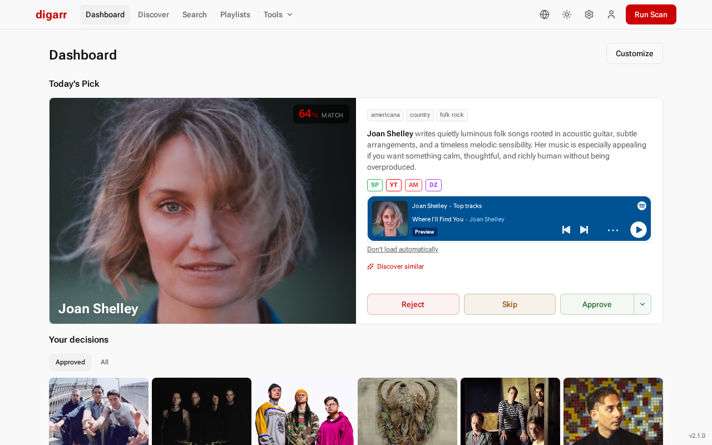

## Discover

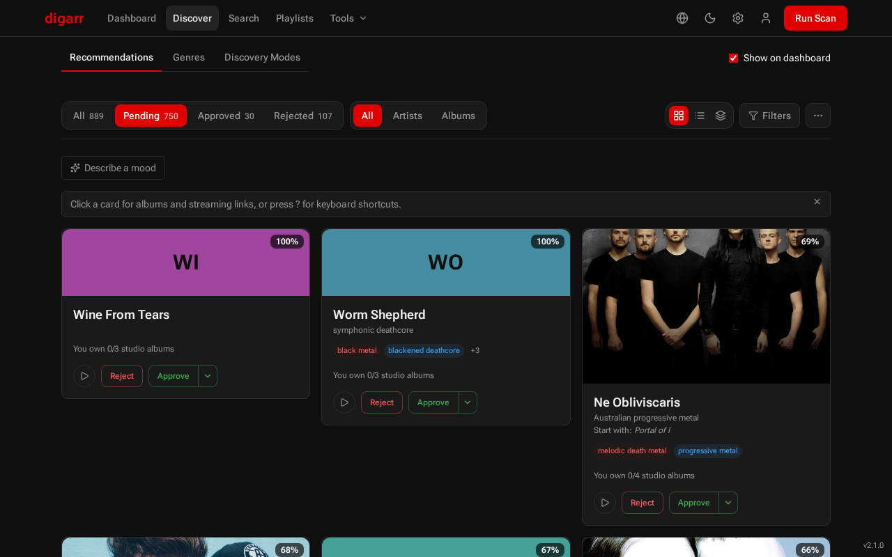

The normal Run Scan action is artist-focused. Use Library Gap-Fill or Release Radar for album recommendations. The empty state also links to the default-off net-new album discovery setting. In v2.0.0, that toggle persists; v1.19.0 cannot save it ([#791](https://github.com/iuliandita/digarr/issues/791)). The links reveal the requested discovery mode or setting. Recommendation saves omit global writes. Image-source controls now live in Connections > Artist images; admins can edit them and members see a read-only row. An image save reports partial success if its later server write fails. v1.19.0 retains the false save failure described in [#792](https://github.com/iuliandita/digarr/issues/792); read back user preferences there to verify the saved value. The older capture predates the Connections picker and Artist images row.

Since v1.19.0, Discover can order and browse genre-priority groups without changing scores. The Audition queue retains a dismissible summary of unavailable-preview reasons after skipping items or finishing.

The **Get missing albums** action opens a studio-album checklist from a recommendation's expanded artist details, including Gap-Fill results and approved artists. All missing albums start selected; untick any you do not want and check the selected count before choosing **Get selected albums**. The dialog reports when nothing is missing or a lookup fails. Partial approval keeps failed albums visible for retry and shows how many succeeded and failed. Approval means the target accepted the album request, not that its download finished. Only MusicBrainz Album groups without secondary types appear, using your synced library to decide what is missing. Lidarr monitors and searches only the selected albums. These captures predate the dialog.

Since the UI refresh (captures above predate it), the Discover toolbar is one row: status and kind controls, the view switch, a Filters popover (discovery order and decades) and a More menu with the bulk actions (approve above or reject below a threshold, Audition, Select), export, metadata refresh, Clear All and feedback insights. On small screens it is two rows and the view switch moves into More. Grid cards lead with the artist image and keep a single action row; streaming links and the metadata cache dot sit in the expanded card. Reject opens the same reason picker in every view, with a one-click "Reject without a reason" path. The mood search is a button until you click it or press `/`. Keyboard shortcuts are listed in the `?` dialog.

## Discovery Modes

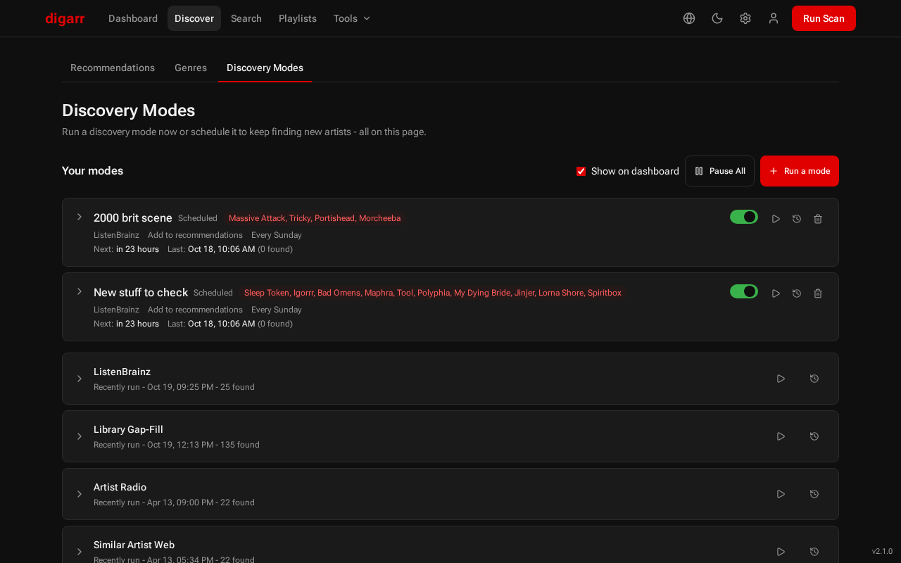

The capture above predates the unified Discovery Modes page at `/discovery-modes`, reached from the Discovery Modes tab on Discover. Your modes now shows compact scheduled and recently run rows. Run a mode opens a searchable picker, where connection requirements and experimental modes appear. Picking a mode opens its Easy/Advanced form with Run now and Schedule actions. Presets and CSV/M3U/XSPF imports live in the add flow. Old `/discover/modes` and `/subscriptions` links redirect; `?mode=<id>` still opens and focuses the requested form.

The picker uses the same Show experimental integrations preference as Connections. TIDAL Favorite Artists remains experimental; live-account validation is deferred. See [TIDAL feedback](AUTHENTICATION.md#tidal-feedback).

## Search

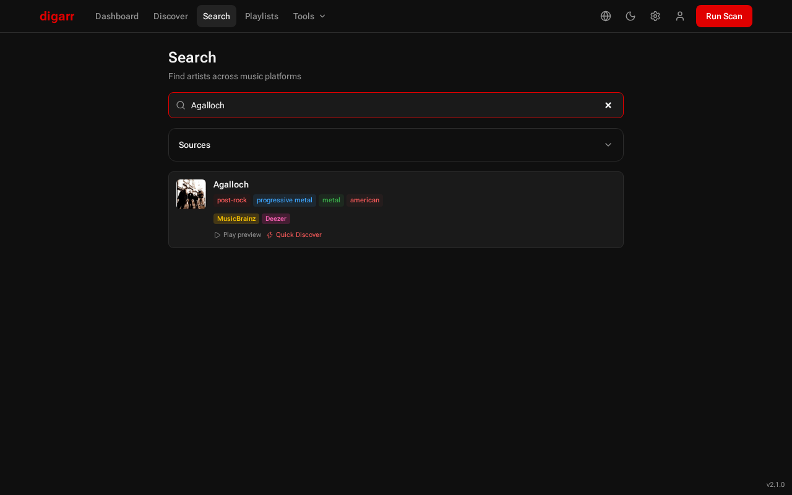

Since the UI refresh, the provider toggles sit under a collapsed Sources section, because every available source is searched by default; its title counts the sources narrowing a search. TIDAL and Bandcamp choices now appear only when the admin enables Show experimental integrations in the Connections picker. The search capture predates this switch.

## Genres

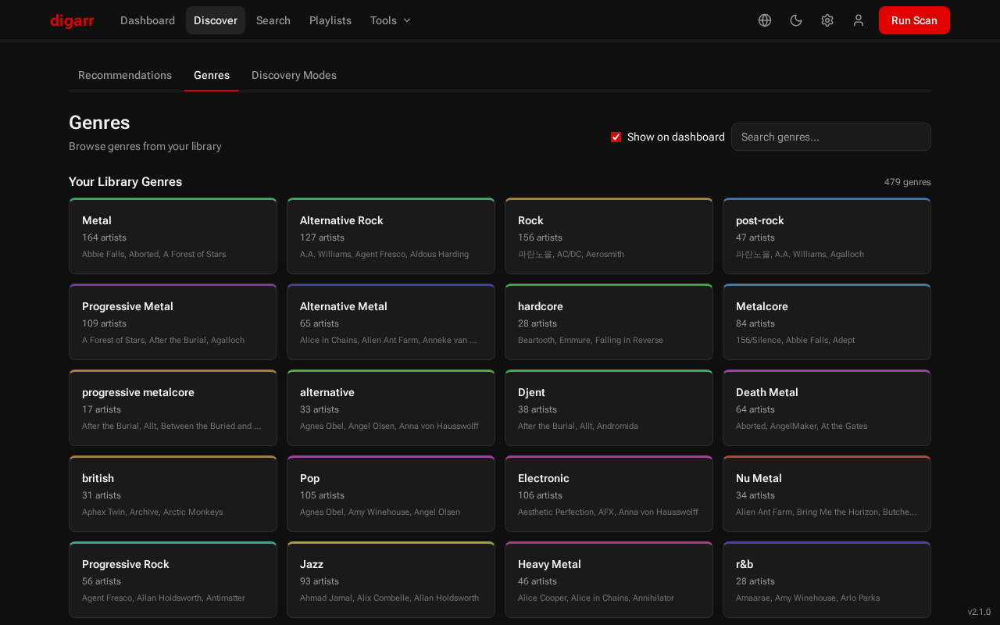

## Genre Detail

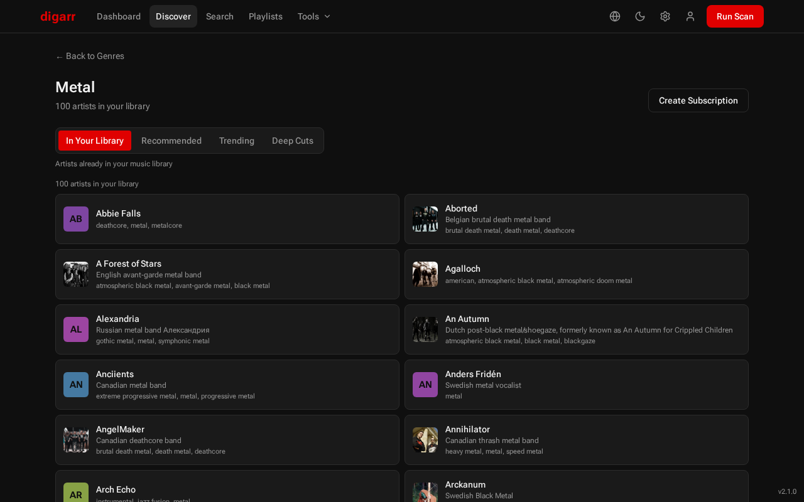

## Playlists

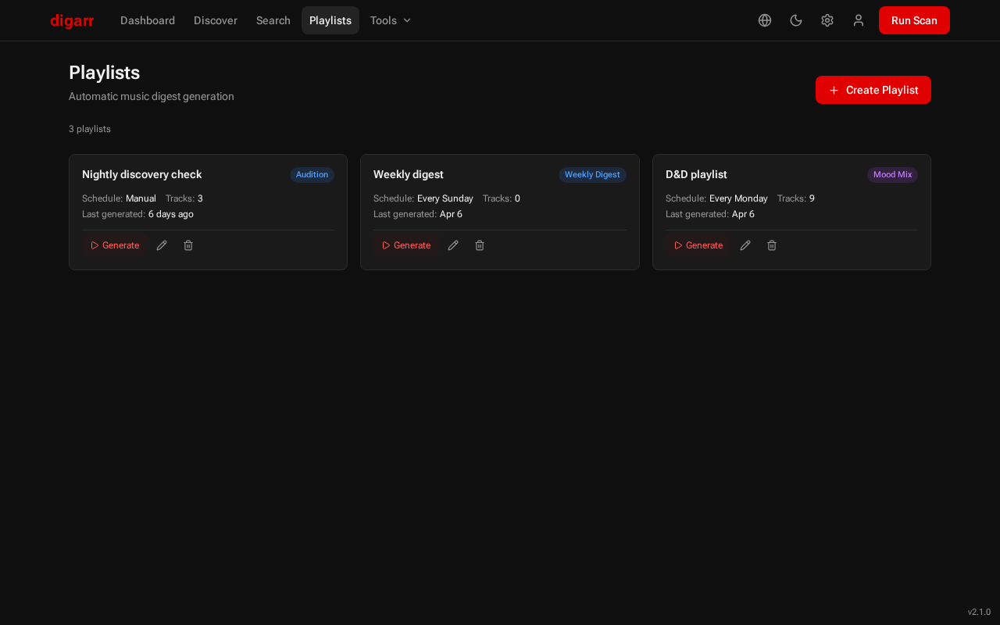

Since v1.18.0, the playlist form also offers Audition: one track per pending artist, with the existing schedule and target controls.

In v1.19.0, playlist details also show the latest local generation outcome, selected/resolved/included artist counts, and per-artist lookup or size-limit results. These do not verify remote delivery or playback.

## Subscriptions

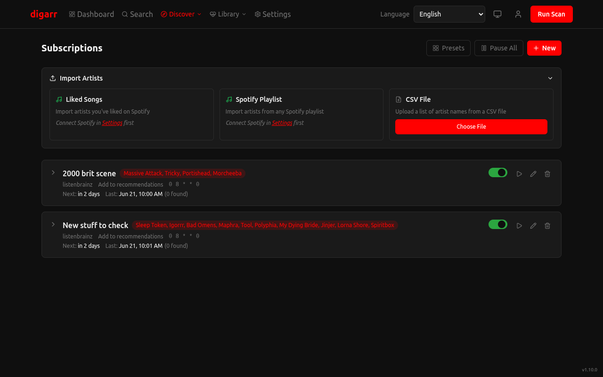

This historical capture shows the retired standalone page. Its schedules, history, pause/resume, bulk controls, presets, and imports now live on Discovery Modes. Settings > Schedule collects the scan, mode, playlist, library-sync, and notification-digest schedules with edit links, and holds the admin Scheduled generation switch. No screenshots were regenerated for this change.

## Library - Health

Open `/library?tab=health`. The historical capture predates the shared Library tabs.

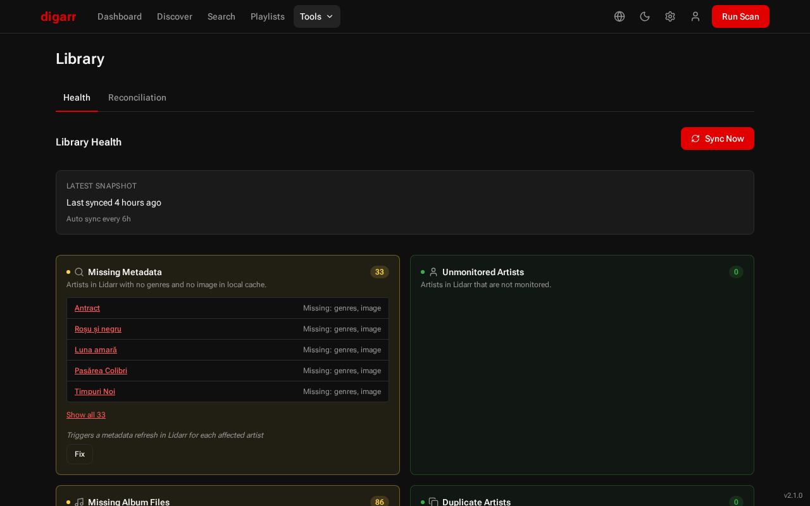

## Library - Reconciliation

Open `/library?tab=reconciliation`. The historical capture predates the shared Library tabs.

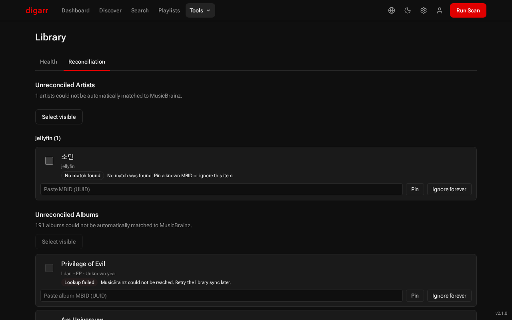

Shipped in `v0.17.0`: unreconciled-artist review plus manual correct/ignore override flow. Extended in `v0.19.0` with unreconciled-album review and album override persistence. Since `v1.15.0`, the view labels each artist and album as no match found, ambiguous match, or lookup failed; eligible rows can be selected, then ignored together through a confirmation dialog. Artist selection covers visible rows, album selection stays on the current page, and failed lookups remain available for retry instead of bulk ignore.

## Library Sources Panel

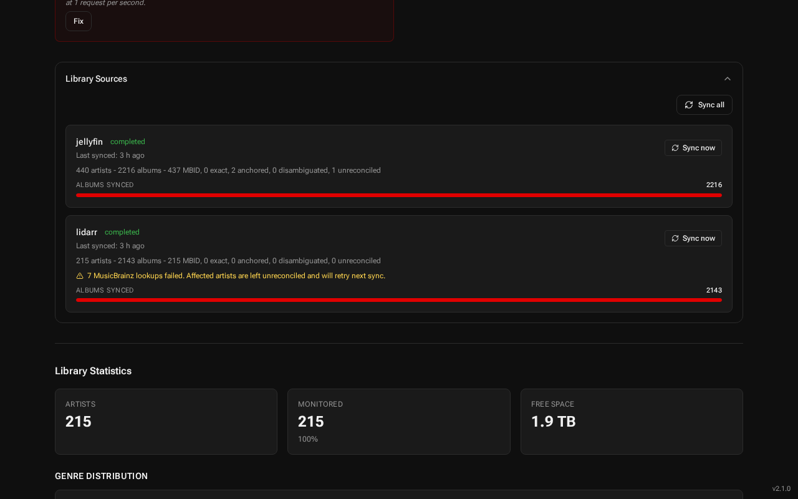

Admin panel on Library > Health. Shipped in `v0.17.0` and expanded in `v0.18.0` with per-source album sync counts and snapshot status. Polished in `v0.19.0` with album sync coverage summaries.

## Analytics

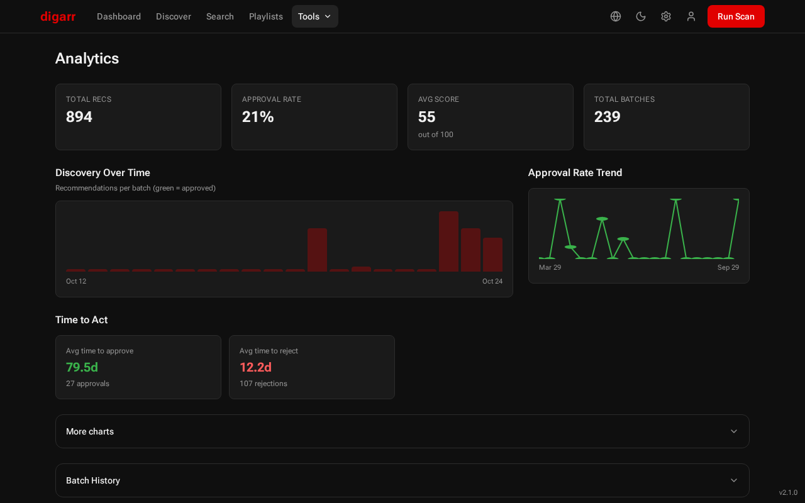

The Discovery over time chart shows per-batch recommendation totals, with the approved portion in green.

## Settings

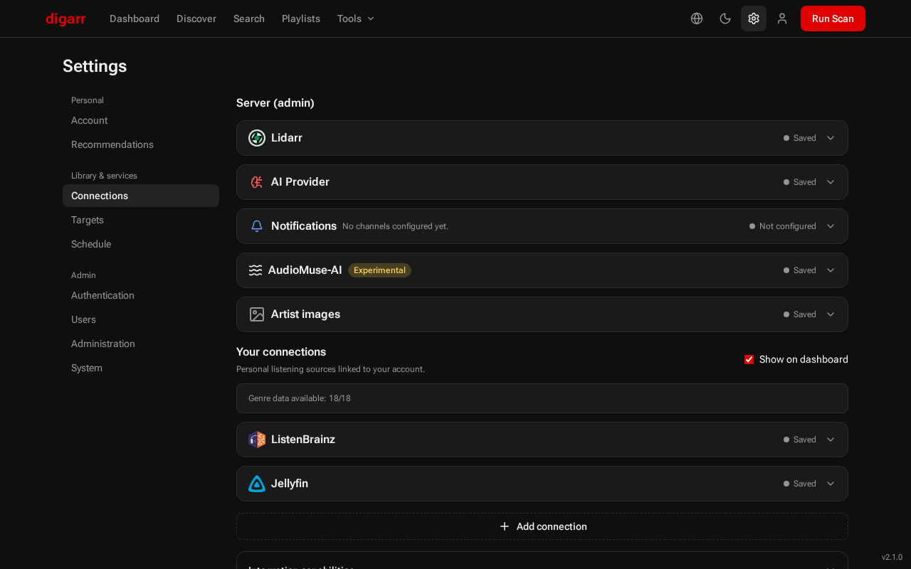

Since the UI refresh, Settings sections sit in a grouped side menu (Personal, Library & services, Admin) on desktop and a grouped select on small screens; the capture above predates it. Connections now lists saved services only, plus the Artist images row for built-in image providers. Add connection opens a grouped searchable picker with the admin experimental switch at the bottom; the screenshots predate this layout. Each listed service is a collapsed row with its status (Not configured, Saved, Test passed, Test passed - not saved yet, Error, or Connected for OAuth links), and rarely used fields sit in collapsed Advanced blocks.

In v1.18.0, the Settings > Targets flow includes `slskd` target creation with an optional linked Lidarr target and a download root visible to Lidarr. The Plex connection card also has a per-user listener selector populated by Test Connection; these controls are newer than the capture above.

In v1.19.0, Settings > Recommendations includes optional primary and secondary genre lists for Discover ordering and browsing.

In v2.0.0, Settings > Administration asks for confirmation before uploading a selected backup. A key mismatch requires a separate **Restore Anyway** confirmation. These dialogs are not shown in the existing Settings capture; they use the shared translated confirmation dialog and existing theme styles.

## Settings > Account

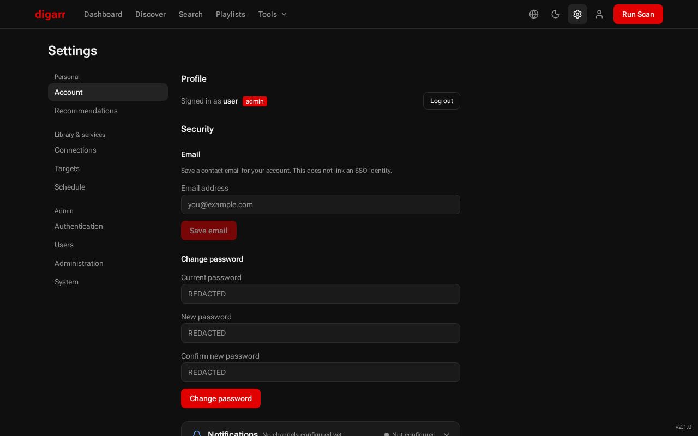

The Account page offers password-confirmed SSO linking when OIDC is enabled and the local account is not linked yet. Linked accounts show their status; callback outcomes appear in a dismissible message. A Tips section brings back dismissed help tips. This capture uses a sample account with OIDC enabled.

## Settings > Connections > Your Connections

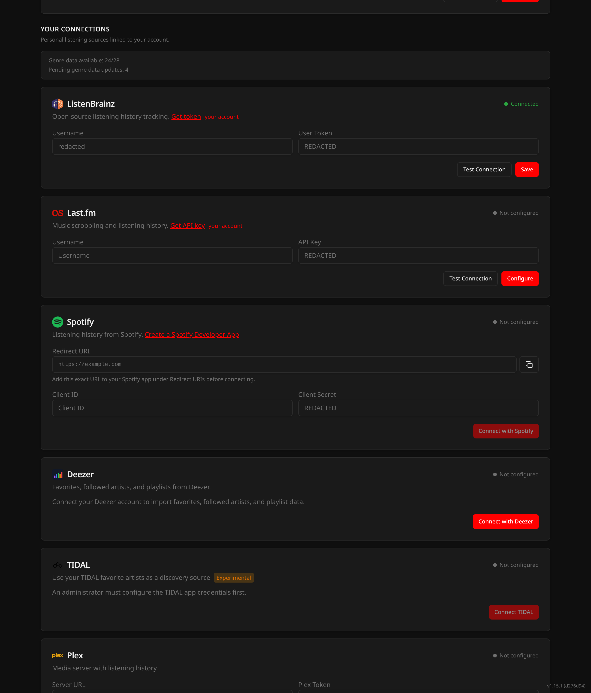

This older capture shows ListenBrainz, Last.fm, Spotify, Deezer, and TIDAL, plus the top of the Plex card. Jellyfin, Emby, Subsonic/Navidrome, and Discogs are also supported. The current list shows only saved services, including incomplete credentials; unconfigured services are in Add connection. The capture above shows the old all-services list. Input values and the instance host are redacted in the capture. The TIDAL card carries the Experimental badge while live-account connect, refresh, and populated favorite-artist results remain unverified; connecting TIDAL requires an admin to configure the app credentials first. See [TIDAL feedback](AUTHENTICATION.md#tidal-feedback) for safe community reporting.

The capture script can produce `settings-connections-picker.png` from the open Add connection panel. It uses the Add connection and Search connections accessible names; that artifact is not checked in yet.

## Settings > Recommendations > Blocked

The screenshot capture script can produce `settings-blocked.png` by opening `/settings?tab=blocked`, which lands on the Blocked section at the bottom of Settings > Recommendations. That section holds separate permanent artist and album blocklists; no `settings-blocked.png` artifact is currently checked in.
