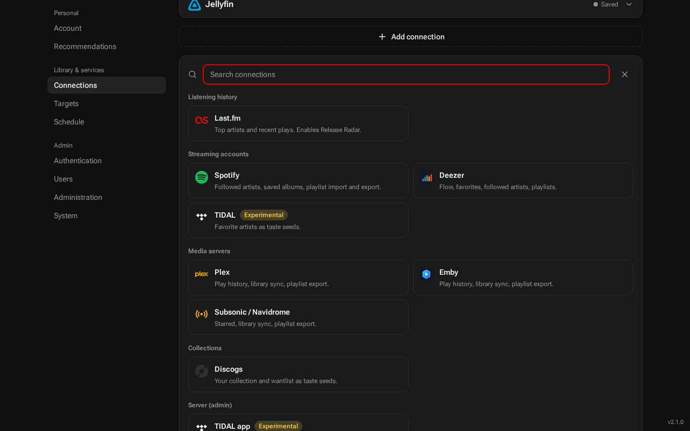

# Screenshots

The checked-in screenshots were captured from a v2.1.0 (`97eefd8d`) deployment with the
Youtarr theme at 1280x800. Usernames, email addresses, the instance host, and credential
input values are redacted by the capture script. Capture a fresh set with
`bun scripts/capture-screenshots.ts`; see that script's header for environment variables.

First-time browser setup starts with account creation before the setup wizard; these
captures show an instance that is already set up.

## Dashboard (dark)

Customize lists every card, including hidden and empty cards, with visibility, size, pointer drag handles, move buttons, and arrow-key reordering. Screen readers hear the new position. Small, medium, and large span one, two, and three desktop columns and fill the width on phones. Reset to default restores Today's Pick, Your decisions, Listening, Genres, and Subscriptions. The layout follows the signed-in account. Empty cards hide unless Show empty cards is enabled; listening-source failures remain visible in the affected view. When Today's Pick has no recommendations, Run Scan stays available in the dashboard header.

Your decisions switches between Approved and All; Listening switches between Top artists and Recently Played. Card headings link to their source page. Genres, Subscriptions, Discover's pending and decision views, and Settings > Connections expose the same visibility preference through Show on dashboard.

Listening tiles distinguish an unconfigured account, empty history, and a failed fetch. Network or request failures, and upstream failures returned as HTTP 200 with `status: error`, retain cached entries with a retry notice.

## Dashboard (light)

## Discover

The Discover toolbar is one row: status and kind controls, the view switch, a Filters popover (discovery order and decades) and a More menu with the bulk actions (approve above or reject below a threshold, Audition, Select), export, metadata refresh, Clear All and feedback insights. On small screens it is two rows and the view switch moves into More. Grid cards lead with the artist image and keep a single action row; streaming links and the metadata cache dot sit in the expanded card. Reject opens the same reason picker in every view, with a one-click "Reject without a reason" path. The mood search is a button until you click it or press `/`. Keyboard shortcuts are listed in the `?` dialog.

The normal Run Scan action is artist-focused. Use Library Gap-Fill or Release Radar for album recommendations. The empty state also links to the default-off net-new album discovery setting. Discover can order and browse genre-priority groups without changing scores. The Audition queue retains a dismissible summary of unavailable-preview reasons after skipping items or finishing.

The **Get missing albums** action opens a studio-album checklist from a recommendation's expanded artist details, including Gap-Fill results and approved artists. All missing albums start selected; untick any you do not want and check the selected count before choosing **Get selected albums**. The dialog reports when nothing is missing or a lookup fails. Partial approval keeps failed albums visible for retry and shows how many succeeded and failed. Approval means the target accepted the album request, not that its download finished. Only MusicBrainz Album groups without secondary types appear, using your synced library to decide what is missing. Lidarr monitors and searches only the selected albums.

## Discovery Modes

The Discovery Modes page at `/discovery-modes` is reached from the Discovery Modes tab on Discover. Your modes shows compact scheduled and recently run rows. Run a mode opens a searchable picker, where connection requirements and experimental modes appear. Picking a mode opens its Easy/Advanced form with Run now and Schedule actions. Schedule stays in that card, with a preset select and Custom cron input; More options holds the name, artist cap, and scoring preset. Saved rows expand to the same compact editor. Presets and CSV/M3U/XSPF imports live in the add flow. Old `/discover/modes` and `/subscriptions` links redirect here; `?mode=<id>` still opens and focuses the requested form.

Schedules, history, pause/resume, and bulk controls for the former Subscriptions page live here. Settings > Schedule collects the scan, mode, playlist, library-sync, and notification-digest schedules with edit links, and holds the admin Scheduled generation switch.

The picker uses the same Show experimental integrations preference as Connections. TIDAL Favorite Artists remains experimental; live-account validation is deferred. See [TIDAL feedback](AUTHENTICATION.md#tidal-feedback).

## Search

The provider toggles sit under a collapsed Sources section, because every available source is searched by default; its title counts the sources narrowing a search. TIDAL and Bandcamp choices appear only when the admin enables Show experimental integrations in the Connections picker.

## Genres

## Genre Detail

## Playlists

The playlist form also offers Audition: one track per pending artist, with the existing schedule and target controls. Playlist details show the latest local generation outcome, selected/resolved/included artist counts, and per-artist lookup or size-limit results. These do not verify remote delivery or playback.

## Library - Health

Open `/library?tab=health`.

## Library - Reconciliation

Open `/library?tab=reconciliation`.

Lists unreconciled artists and albums with manual correct/ignore overrides. Each row is labelled as no match found, ambiguous match, or lookup failed; eligible rows can be selected, then ignored together through a confirmation dialog. Artist selection covers visible rows, album selection stays on the current page, and failed lookups remain available for retry instead of bulk ignore.

## Library Sources Panel

Admin panel in a collapsible section on Library > Health, with per-source sync status, album sync counts, reconciliation totals, and failed lookup warnings.

## Analytics

The Discovery over time chart shows per-batch recommendation totals, with the approved portion in green.

## Settings

Settings sections sit in a grouped side menu (Personal, Library & services, Admin) on desktop and a grouped select on small screens. Connections lists saved services only, plus the Artist images row for built-in image providers; Your connections holds the personal listening sources linked to your account. Each listed service is a collapsed row with its status (Not configured, Saved, Test passed, Test passed - not saved yet, Error, or Connected for OAuth links), and rarely used fields sit in collapsed Advanced blocks.

Settings > Targets includes `slskd` target creation with an optional linked Lidarr target and a download root visible to Lidarr. The Plex connection card has a per-user listener selector populated by Test Connection. Settings > Recommendations includes optional primary and secondary genre lists for Discover ordering and browsing, and the Blocked section with separate permanent artist and album blocklists (`/settings?tab=blocked` opens it). Settings > Administration asks for confirmation before uploading a selected backup; a key mismatch requires a separate **Restore Anyway** confirmation.

## Settings > Connections > Add connection

Add connection opens a grouped searchable picker of the services that are not saved yet, with the admin experimental switch at the bottom. The TIDAL entries carry the Experimental badge while live-account connect, refresh, and populated favorite-artist results remain unverified; connecting TIDAL requires an admin to configure the app credentials first. See [TIDAL feedback](AUTHENTICATION.md#tidal-feedback) for safe community reporting.

## Settings > Account

The Account page offers password-confirmed SSO linking when OIDC is enabled and the local account is not linked yet. Linked accounts show their status; callback outcomes appear in a dismissible message. A Tips section brings back dismissed help tips.

The Account page also manages personal notification channels for your own request decisions (subscribe explicitly to request outcomes; new channels leave the event off) and personal API tokens. After creating a token, its one-time reveal includes a copyable MCP client configuration with `type: "http"`, the endpoint URL, and the bearer header; closing the dialog removes the token and configuration from view.

## User management and approval requests

The user-management page adds per-user approval policies, a trusted score threshold, and an optional open-request limit. Its Requests section shows the admin queue with scores, reasons, and approve/decline decisions with optional notes. Members see their pending and declined requests on Discover > Approved. These controls are not captured; see [approval policies](AUTHENTICATION.md#approval-policies) for the workflow.
