# Screenshots

Captured from a v2.1.0 (`97eefd8d`) installation with the Youtarr theme at 1280x800.
Account names, email addresses, the instance host, private IP addresses, service URLs,
internal hostnames, and credential values are redacted. Capture a fresh set with
`bun scripts/capture-screenshots.ts`; see that script's header for environment variables.

## Dashboard (dark)

Customize lists every card, including hidden and empty cards, with visibility, size, pointer drag handles, move buttons, and arrow-key reordering. Small, medium, and large span one, two, and three desktop columns and fill the width on phones. Reset to default restores Today's Pick, Your decisions, Listening, Genres, and Subscriptions. The layout follows the signed-in account. Empty cards hide unless Show empty cards is enabled. When Today's Pick has no recommendations, Run Scan stays available in the dashboard header.

Your decisions switches between Approved and All; Listening switches between Top artists and Recently Played. Card headings link to their source page. Genres, Subscriptions, Discover, and Settings > Connections have a Show on dashboard toggle.

Listening tiles distinguish an unconfigured account, empty history, and a failed fetch. Failed fetches keep cached entries and show a retry notice.

## Dashboard (light)

## Discover

The toolbar holds the status and kind controls, the view switch, a Filters popover (discovery order and decades) and a More menu with bulk actions (approve above or reject below a threshold, Audition, Select), export, metadata refresh, Clear All and feedback insights. On small screens it wraps to two rows and the view switch moves into More. Grid cards lead with the artist image; streaming links and albums are in the expanded card. Reject opens a reason picker with a one-click "Reject without a reason" path. Press `/` for mood search and `?` for keyboard shortcuts.

Run Scan finds artists. Library Gap-Fill and Release Radar find albums. Discover can order and browse genre-priority groups without changing scores. The Audition queue keeps a dismissible summary of unavailable previews.

**Get missing albums** in a recommendation's expanded details opens a checklist of the artist's studio albums missing from your synced library, all selected by default. **Get selected albums** sends the selection to Lidarr, which monitors and searches only those albums. Failed albums stay visible for retry. Approval means the target accepted the request, not that the download finished.

## Discover - list and stack views

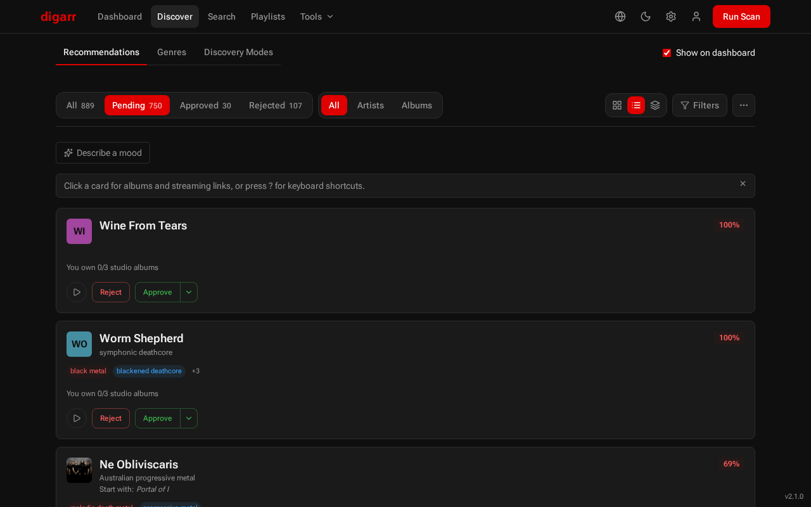

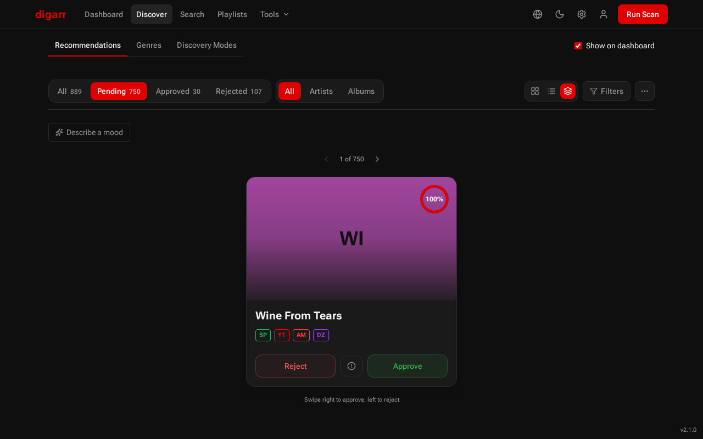

List view shows the cards in one column. Stack view shows one recommendation at a time with a position counter; swipe right to approve and left to reject, or use the buttons.

## Discovery Modes

`/discovery-modes`, also the Discovery Modes tab on Discover. Your modes lists scheduled and recently run modes with schedule, history, pause/resume, and bulk controls. Picking a mode opens its Easy/Advanced form with Run now and Schedule; More options holds the name, artist cap, and scoring preset. `?mode=<id>` opens a specific form.

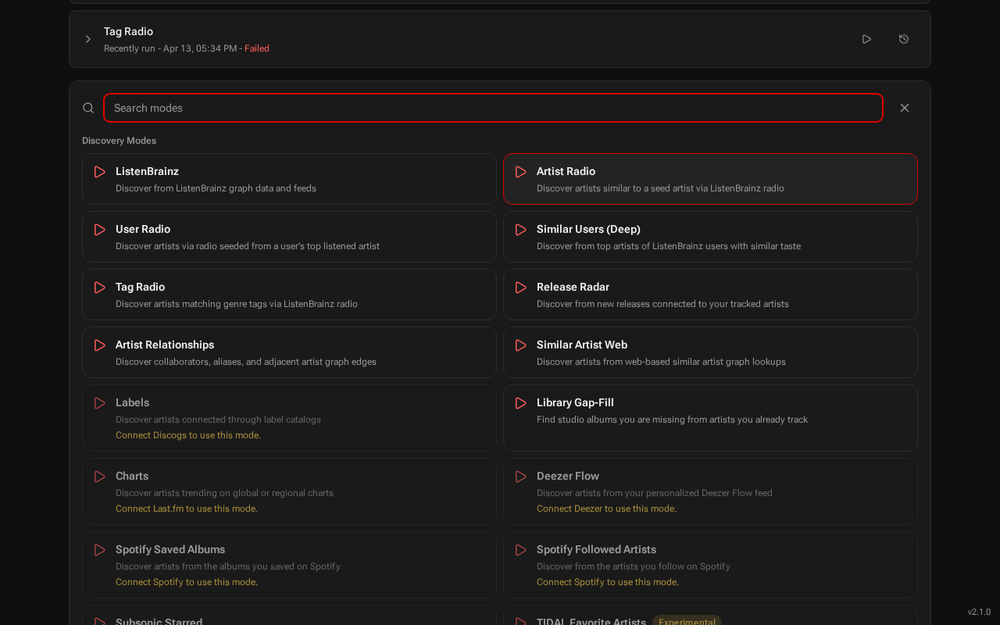

Run a mode opens a searchable picker. Modes that need an unconnected service are dimmed with a link to connect it. Presets and CSV/M3U/XSPF imports are in the same flow. Experimental modes such as TIDAL Favorite Artists appear when Show experimental integrations is on; see [TIDAL feedback](AUTHENTICATION.md#tidal-feedback).

## Search

Every available source is searched by default; the collapsed Sources section narrows the search and its title counts the selected sources. TIDAL and Bandcamp appear only when Show experimental integrations is on.

## Genres

## Genre Detail

## Playlists

Playlist types include Weekly Digest, Mood Mix, and Audition (one track per pending artist), each with an optional schedule and targets.

## Playlist detail

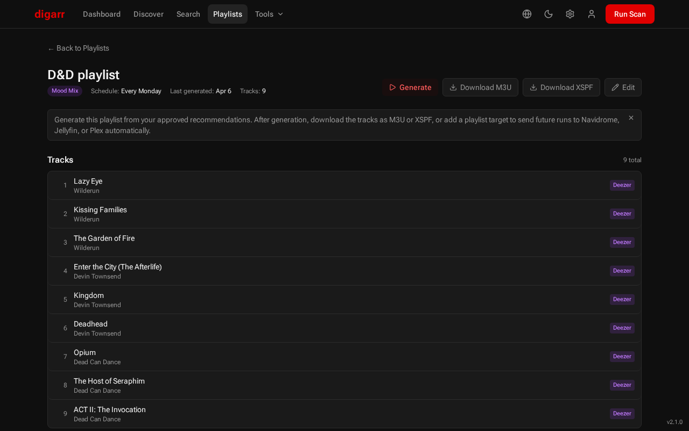

Lists the tracks with their source and offers Generate, M3U and XSPF downloads, and Edit. The latest generation shows selected, resolved, and included artist counts with per-artist results. These do not verify remote delivery or playback.

## Library - Health

`/library?tab=health`.

## Library - Reconciliation

`/library?tab=reconciliation`. Lists unreconciled artists and albums, each labelled no match found, ambiguous match, or lookup failed. Pin a MusicBrainz ID or ignore a row; eligible rows can be ignored together through a confirmation dialog. Failed lookups stay available for retry.

## Library Sources Panel

Admin panel in a collapsible section on Library > Health, with per-source sync status, album counts, reconciliation totals, and failed lookup warnings.

## Analytics

Discovery over time shows per-batch recommendation totals, with the approved portion in green.

## Settings

Settings sections sit in a grouped side menu (Personal, Library & services, Admin) on desktop and a grouped select on small screens. Connections lists saved server services, the Artist images row, and Your connections, the personal listening sources linked to your account. Each service is a collapsed row with its status (Not configured, Saved, Test passed, Test passed - not saved yet, Error, or Connected); rarely used fields sit in collapsed Advanced blocks. The Plex card has a per-user listener selector filled by Test Connection.

## Settings > Connections > Add connection

A grouped, searchable picker of services not saved yet, with the admin experimental switch at the bottom. TIDAL is Experimental: live-account connect, refresh, and favorite-artist results are unverified, and an admin must configure the app credentials first. See [TIDAL feedback](AUTHENTICATION.md#tidal-feedback).

## Settings > Account

Profile, contact email, and password change. With OIDC enabled, an unlinked local account can link SSO after confirming its password. The page also manages personal notification channels for request decisions, personal API tokens (the one-time reveal includes a copyable MCP client configuration), and dismissed tips.

## Settings > Recommendations

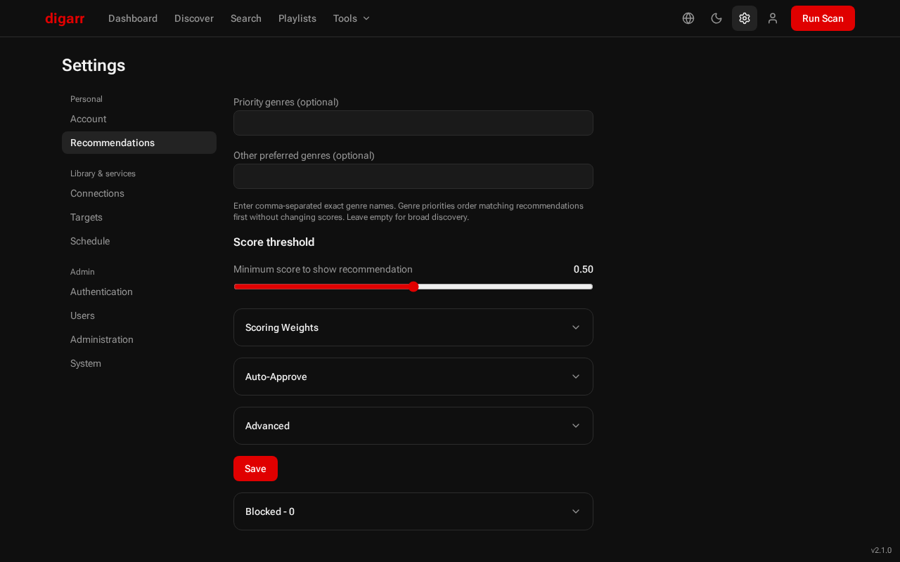

Priority and other preferred genres, score threshold, scoring weights, auto-approve, and the Blocked section with separate permanent artist and album blocklists (`/settings?tab=blocked` opens it).

## Settings > Targets

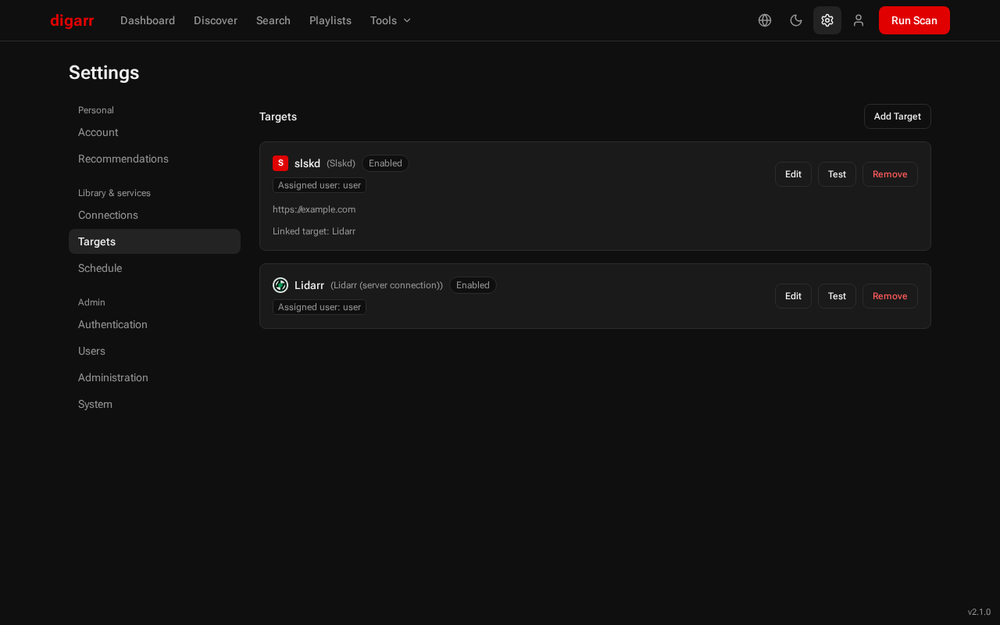

Each target shows its type, assigned user, address, and linked target, with Edit, Test, and Remove. An `slskd` target can link a Lidarr target and needs a download root visible to Lidarr.

## Settings > Schedule

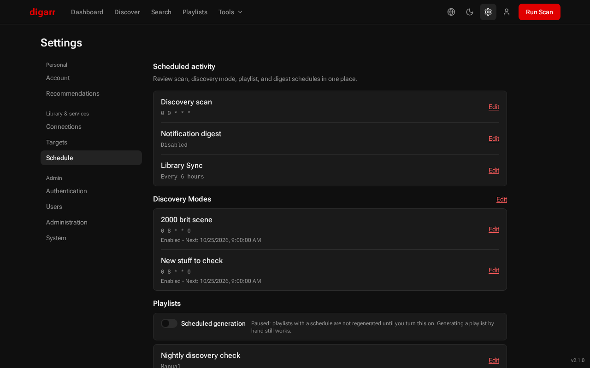

The scan, notification digest, library sync, discovery mode, and playlist schedules in one place with edit links, plus the admin Scheduled generation switch for playlists.

## Settings > Authentication

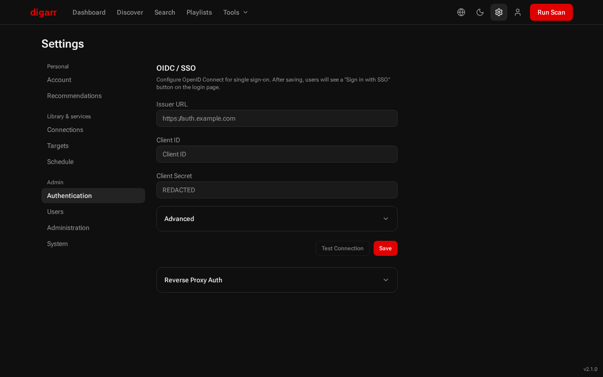

OIDC/SSO settings with a connection test, and reverse proxy authentication.

## Settings > Administration

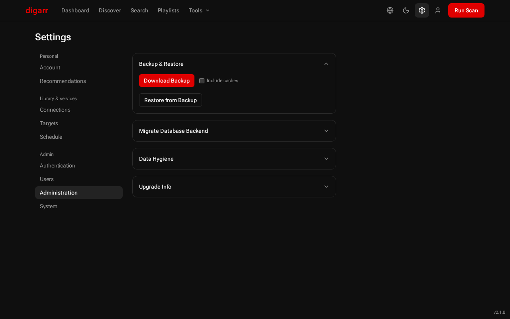

Backup and restore, database backend migration, data hygiene, and upgrade info. Restoring asks for confirmation, and a key mismatch needs a separate **Restore Anyway** confirmation.

## Settings > System

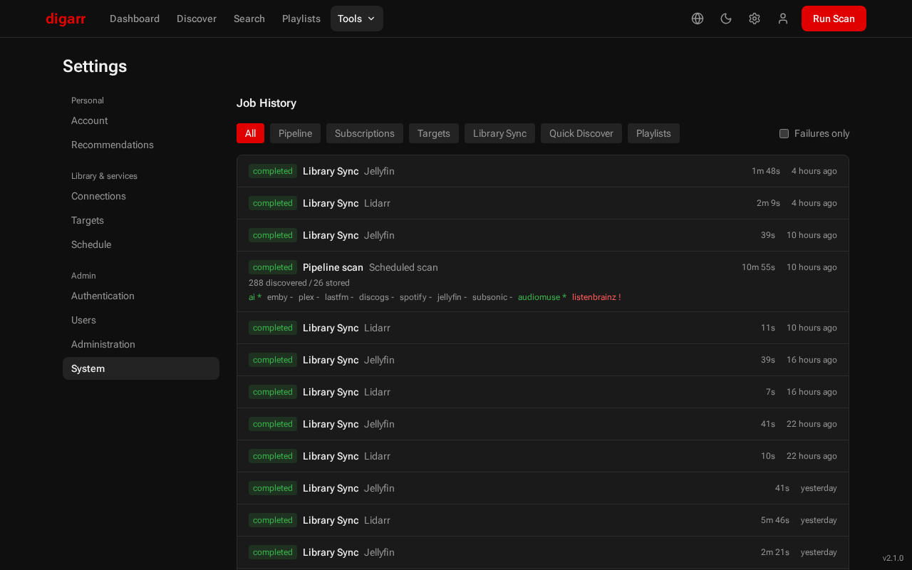

Job History lists pipeline, subscription, target, library sync, quick discover, and playlist runs with per-source results, filterable by type and failures.

## Settings > Users and approval requests

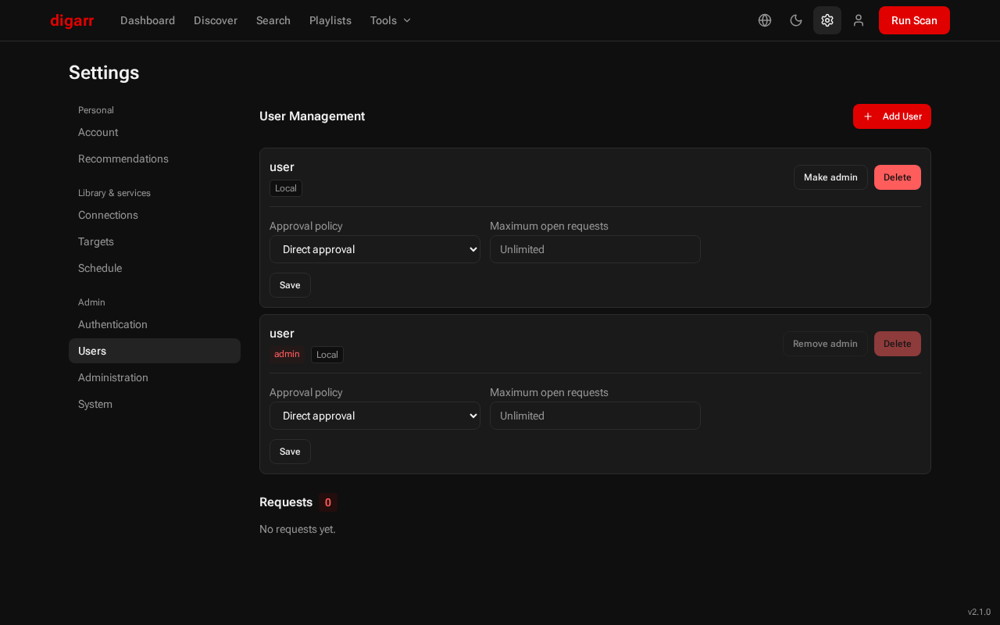

Per-user admin role, approval policy, trusted score threshold, and open-request limit. Requests shows the admin queue with scores, reasons, and approve/decline decisions with optional notes. Members see their pending and declined requests on Discover > Approved. See [approval policies](AUTHENTICATION.md#approval-policies).
